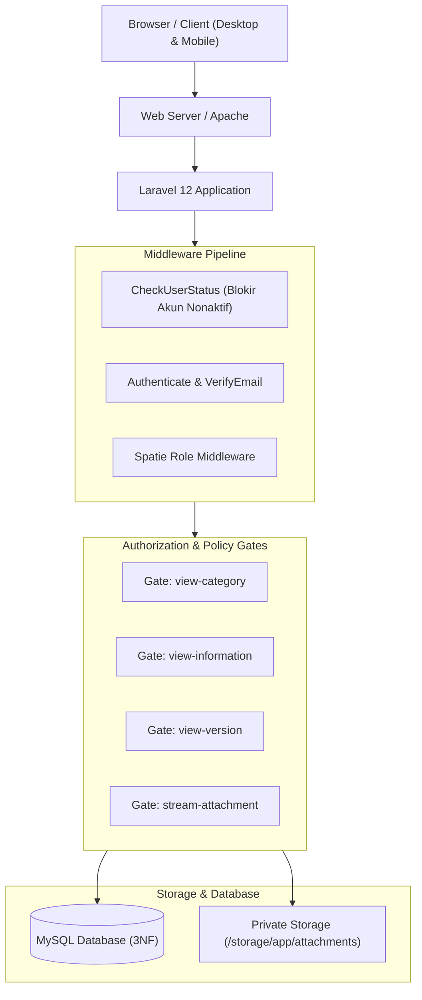
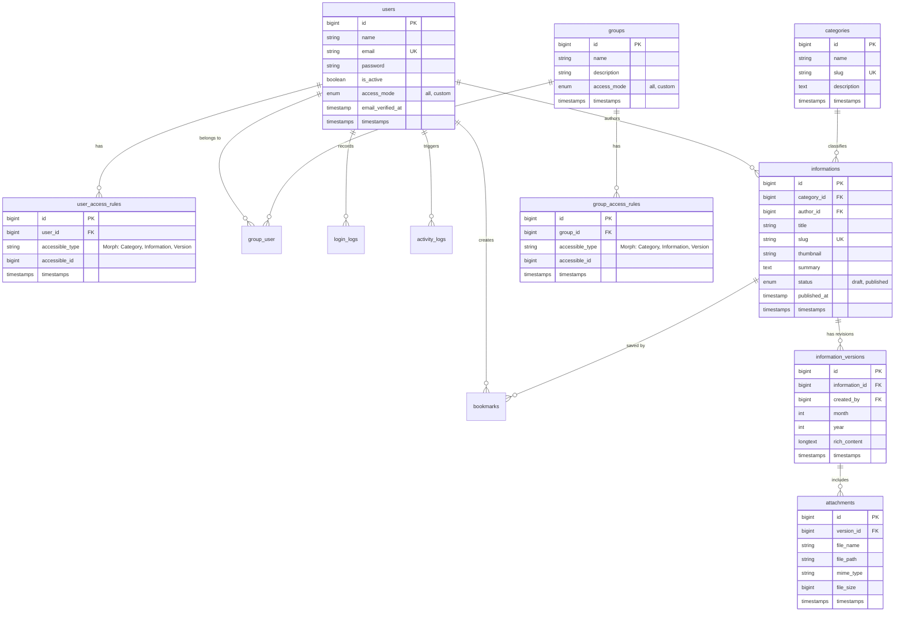

# Dokumentasi Teknis Sistem Portal Informasi Terpusat (InfoHub-IMST)

**PT Industri Manufaktur Sinergi Teknologi (PT IMST)**  
*Dokumen Spesifikasi Teknis, Arsitektur Sistem, Skema Basis Data, dan Panduan Pengembang*

---

## Daftar Isi
1. [Ringkasan Eksekutif & Karakteristik Sistem](#1-ringkasan-eksekutif--karakteristik-sistem)
2. [Spesifikasi Teknologi (Tech Stack)](#2-spesifikasi-teknologi-tech-stack)
3. [Arsitektur Sistem & Alur Kerja](#3-arsitektur-sistem--alur-kerja)
4. [Skema Basis Data (Database Schema - 3NF)](#4-skema-basis-data-database-schema---3nf)
5. [Arsitektur Keamanan & Otorisasi Berjenjang](#5-arsitektur-keamanan--otorisasi-berjenjang)
6. [Struktur Rute & Endpoint (Routing Architecture)](#6-struktur-rute--endpoint-routing-architecture)
7. [Komponen Antarmuka & Frontend (UI/UX)](#7-komponen-antarmuka--frontend-uiux)
8. [Panduan Instalasi & Deployment](#8-panduan-instalasi--deployment)
9. [Pengujian Otomatis (Automated Testing Suite)](#9-pengujian-otomatis-automated-testing-suite)
10. [Akun Bawaan (Default Credentials)](#10-akun-bawaan-default-credentials)

---

## 1. Ringkasan Eksekutif & Karakteristik Sistem

**InfoHub-IMST** (*IMST Corporate Information Portal*) adalah aplikasi berbasis web yang dirancang khusus sebagai **Single Source of Truth** (sumber data dan informasi tunggal) bagi PT Industri Manufaktur Sinergi Teknologi. 

Aplikasi ini mengelola dokumen resmi korporat, regulasi internal, pengumuman manajemen, serta histori dokumen bulanan dengan kontrol akses berlapis.

### Karakteristik Utama:
- **Zero-Access by Default**: Setiap pengguna baru dengan peran *Viewer* tidak memiliki hak melihat dokumen apa pun secara bawaan hingga hak akses diberikan secara eksplisit.
- **Granular Access Control**: Hak akses dapat diberikan per Kategori, per Dokumen Informasi, atau spesifik per Versi Bulanan.
- **Dual-Layer Authorization**: Hak akses dihitung dari penggabungan (*union*) izin langsung pengguna (*Individual Access*) dan izin kelompok departemen (*Group Access*).
- **Proteksi Dokumen Digital**: Lampiran PDF di-stream melalui gate otorisasi dengan enkripsi URL dan pembatasan fitur print/download bawaan browser.
- **Light Mode Only Corporate Aesthetic**: Antarmuka bersih, modern, dan profesional dengan palet warna resmi IMST (`#1044D1`) tanpa distraksi dark mode atau animasi berlebihan.

---

## 2. Spesifikasi Teknologi (Tech Stack)

### Backend
- **Framework**: Laravel 12.x
- **Bahasa Pemrograman**: PHP 8.2+
- **Database Engine**: MySQL 8.x / MariaDB (Mendukung transaksi ACID dan InnoDB)
- **Paket Otorisasi**: Spatie Laravel-Permission v6.25+
- **Autentikasi**: Laravel Breeze (Blade Stack)

### Frontend
- **CSS Framework**: Tailwind CSS v3.x & @tailwindcss/forms
- **Reaktivitas UI**: Alpine.js v3.x
- **Bundler & Compiler**: Vite v7.x
- **Komponen Notifikasi**: SweetAlert2 v11.x
- **Typography**: Google Font "Outfit"

### Testing & Kualitas Kode
- **Test Runner**: PHPUnit 11.5+
- **Static Analysis**: Larastan (PHPStan) v3.12+
- **Code Linter**: Laravel Pint v1.24+

---

## 3. Arsitektur Sistem & Alur Kerja



---

## 4. Skema Basis Data (Database Schema - 3NF)

Basis data dirancang dengan normalisasi tingkat ketiga (**Third Normal Form / 3NF**) untuk memastikan integritas data, efisiensi relasi, dan nihilnya redundansi data.

### Entity Relationship Diagram (ERD)



---

## 5. Arsitektur Keamanan & Otorisasi Berjenjang

### 5.1 Peran dan Kewenangan Pengguna (RBAC)
Sistem memiliki 3 role utama yang dikelola melalui `spatie/laravel-permission`:

| Peran (Role) | Ruang Lingkup Hak Akses |
| :--- | :--- |
| **Super Admin** | Akses mutlak (*Superuser*). Mengelola seluruh user, konfigurasi hak akses granular, grup departemen, banner, pengaturan aplikasi, audit log, dan backup/restore basis data. |
| **Admin Kesekretariatan** | Mengelola konten portal. Membuat dan memperbarui kategori, informasi/dokumen, riwayat versi bulanan, dan mengunggah lampiran PDF. |
| **Viewer** | Mengakses konten informasi, membaca versi bulanan dokumen yang diizinkan, mengunduh/membaca dokumen lampiran resmi, dan menandai favorit (*bookmark*). |

### 5.2 Mekanisme Resolusi Akses Efektif
Pada model `User` (`app/Models/User.php`), hak akses dihitung secara dinamis melalui relasi hierarkis:

```php
// Menentukan apakah user memiliki akses penuh tanpa filter
public function hasFullAccess(): bool
{
    if ($this->hasAnyRole(['Super Admin', 'Admin Kesekretariatan'])) return true;
    if ($this->access_mode === 'all') return true;
    return $this->groups()->where('access_mode', 'all')->exists();
}
```

Jika `hasFullAccess()` bernilai `false`, sistem menggabungkan hak akses individu dan kelompok:
1. **Kategori yang Diizinkan (`getAllowedCategoryIds`)**:
   - Izin langsung kategori pada user + izin kategori pada grup.
   - Kategori dari dokumen informasi yang diizinkan secara langsung.
   - Kategori dari versi bulanan yang diizinkan secara langsung.
2. **Dokumen Informasi yang Diizinkan (`getAllowedInformationIds`)**:
   - Izin langsung informasi (user + grup).
   - Seluruh informasi di dalam kategori yang diizinkan.
   - Informasi pemilik dari versi bulanan yang diizinkan.
3. **Versi Bulanan yang Diizinkan (`getAllowedVersionIds`)**:
   - Izin langsung versi (user + grup).
   - Seluruh versi dari dokumen informasi yang diizinkan.
   - Seluruh versi dari kategori yang diizinkan.

### 5.3 Otorisasi Gate (`app/Providers/AppServiceProvider.php`)
- `view-category`: Memverifikasi apakah user berhak melihat daftar/kategori terkait.
- `view-information`: Memverifikasi user berhak membuka detail dokumen informasi.
- `view-version`: Memverifikasi user berhak membuka versi bulanan tertentu.
- `stream-attachment`: Mengamankan file lampiran PDF. Akses hanya diizinkan jika user memiliki izin pada versi dokumen induknya.

### 5.4 Proteksi Streaming PDF (`AttachmentController.php`)
File dokumen tidak disimpan di folder publik yang dapat diakses sembarangan, melainkan di-stream melalui respon terproteksi:
- URL Endpoint: `/attachments/stream/{id}`
- Respon HTTP: `Response::file()` dengan header MIME type `application/pdf`.
- Header Cache: `no-cache, no-store, must-revalidate`.
- Tampilan Viewer: Parameter `#toolbar=0&navpanes=0` untuk meminimalkan unduhan tidak sah di lingkungan kerja.

---

## 6. Struktur Rute & Endpoint (Routing Architecture)

### 6.1 Jalur Publik (Guest Routes)
| Method | URI | Controller / Action | Keterangan |
| :--- | :--- | :--- | :--- |
| `GET` | `/` | Redirect Callback | Arahkan ke `/home` jika login, `/login` jika guest |
| `GET` | `/login` | `AuthenticatedSessionController@create` | Halaman login split-screen InfoHub-IMST |
| `POST` | `/login` | `AuthenticatedSessionController@store` | Proses autentikasi user |
| `POST` | `/logout` | `AuthenticatedSessionController@destroy` | Keluar dari sesi |
| `GET` | `/forgot-password` | `PasswordResetLinkController@create` | Formulir minta reset password |
| `POST` | `/forgot-password` | `PasswordResetLinkController@store` | Kirim email reset token |

### 6.2 Jalur Pengguna Terautentikasi (Viewer & Admin)
*Middleware: `auth`, `verified`, `CheckUserStatus`*

| Method | URI | Controller / Action | Keterangan |
| :--- | :--- | :--- | :--- |
| `GET` | `/home` | `HomeController@index` | Beranda portal, carousel banner, pencarian live |
| `GET` | `/info/{slug}` | `ViewerInformationController@show` | Detail dokumen informasi & switcher versi |
| `GET` | `/info/{slug}/version` | `ViewerInformationController@fetchVersion` | Pengambilan konten versi bulanan via AJAX |
| `GET` | `/bookmarks` | `BookmarkController@index` | Daftar dokumen yang dibookmark user |
| `POST` | `/bookmarks/toggle/{id}`| `BookmarkController@toggle` | Toggle bookmark (simpan/hapus) |
| `GET` | `/attachments/stream/{id}`| `AttachmentController@stream` | Streaming dokumen PDF terproteksi Gate |
| `GET` | `/profile` | `ProfileController@edit` | Halaman pengaturan profil & password user |

### 6.3 Jalur Admin Panel (Super Admin & Admin Kesekretariatan)
*Prefix: `/admin`, Middleware: `role:Super Admin\|Admin Kesekretariatan`*

| Method | URI | Controller / Action | Keterangan |
| :--- | :--- | :--- | :--- |
| `GET` | `/admin/dashboard` | `AdminDashboardController@index` | Dashboard statistik korporat |
| `RESOURCE`| `/admin/categories` | `CategoryController` | CRUD Kategori Informasi |
| `RESOURCE`| `/admin/informations`| `InformationController` | CRUD Dokumen Informasi Induk |
| `GET/POST`| `/admin/informations/{id}/versions` | `InformationController@...` | Manajemen riwayat versi bulanan dokumen |

### 6.4 Jalur Khusus Super Admin
*Prefix: `/admin`, Middleware: `role:Super Admin`*

| Method | URI | Controller / Action | Keterangan |
| :--- | :--- | :--- | :--- |
| `RESOURCE`| `/admin/users` | `UserController` | Manajemen user & reset status aktivasi |
| `GET/POST`| `/admin/users/{user}/access` | `UserController@manageAccess` | Atur hak akses granular per user |
| `RESOURCE`| `/admin/groups` | `GroupController` | CRUD Grup departemen/divisi |
| `GET/POST`| `/admin/groups/{group}/access` | `GroupController@manageAccess` | Atur hak akses dokumen per grup |
| `RESOURCE`| `/admin/banners` | `BannerController` | Kelola banner carousel beranda |
| `GET/POST`| `/admin/settings` | `SettingController` | Konfigurasi profil instansi & sistem |
| `GET` | `/admin/logs/activity`| `LogController@activityLogs` | Audit log aktivitas admin |
| `GET` | `/admin/logs/login` | `LogController@loginLogs` | Riwayat log masuk akun pengguna |
| `GET/POST`| `/admin/logs/database`| `LogController@...` | Utilitas backup dan restore database |

---

## 7. Komponen Antarmuka & Frontend (UI/UX)

1. **Light Mode Only**:
   - Seluruh elemen gelap (`dark:`) dan *theme toggler* telah dieliminasi demi kepatuhan terhadap identitas visual korporat PT IMST.
2. **Pola Spacing & Typography**:
   - Font primer: `Outfit` (sans-serif), diimpor via CDN Google Fonts.
   - Ukuran ikon terstandarisasi: 16px (`w-4 h-4`) untuk menu sidebar dan 20px (`w-5 h-5`) untuk field formulir.
3. **Reaktivitas Tanpa Beban Berat (Alpine.js)**:
   - Pencarian real-time dengan *debounce* 300ms pada beranda portal.
   - Switcher histori versi dokumen bulanan dengan pemuatan dinamis tanpa *full reload*.
   - Modal pratinjau dokumen PDF terintegrasi.
   - *Show/Hide Password toggle* pada formulir autentikasi.

---

## 8. Panduan Instalasi & Deployment

### 8.1 Persyaratan Server
- Web Server: Apache 2.4+ atau Nginx 1.20+
- PHP: Versi 8.2 atau lebih baru (dengan ekstensi `pdo_mysql`, `mbstring`, `openssl`, `tokenizer`, `xml`, `ctype`, `json`, `fileinfo`)
- Basis Data: MySQL 8.0+ atau MariaDB 10.4+
- Composer: Versi 2.x
- Node.js & NPM: Node.js 18.x+ dan NPM 9.x+

### 8.2 Prosedur Instalasi di Lingkungan Baru

1. **Kloning Repositori**:
   ```bash
   git clone <repository-url> Portal-IMST
   cd Portal-IMST
   ```

2. **Instalasi Dependensi PHP & Node.js**:
   ```bash
   composer install
   npm install
   ```

3. **Konfigurasi Lingkungan (`.env`)**:
   ```bash
   cp .env.example .env
   php artisan key:generate
   ```
   Sesuaikan parameter database di file `.env`:
   ```env
   DB_CONNECTION=mysql
   DB_HOST=127.0.0.1
   DB_PORT=3306
   DB_DATABASE=portal_imst
   DB_USERNAME=root
   DB_PASSWORD=
   ```

4. **Migrasi Basis Data & Seeding**:
   ```bash
   php artisan migrate --seed
   ```

5. **Pembuatan Storage Symlink**:
   ```bash
   php artisan storage:link
   ```

6. **Kompilasi Aset Frontend**:
   ```bash
   npm run build
   ```

7. **Menjalankan Server Lokal (Opsional)**:
   ```bash
   php artisan serve
   ```

---

## 9. Pengujian Otomatis (Automated Testing Suite)

Sistem telah dilengkapi dengan pengujian menyeluruh (Unit & Feature Tests) dengan tingkat kelulusan 100%.

### Menjalankan Seluruh Pengujian:
```bash
php artisan test
```

### Ruang Lingkup Test Suite (35 Skenario Lulus):
- `AuthenticationTest`: Pengujian login, validasi email/password salah, dan sesi keluar.
- `EmailVerificationTest` & `PasswordResetTest`: Alur verifikasi surat elektronik dan pembaruan sandi token.
- `GroupAccessControlTest`: Pewarisan izin grup departemen, penggabungan izin efektif (*union*), pencabutan izin grup tanpa mengganggu izin individual, dan proteksi streaming dokumen via grup.
- `UserAccessControlTest`: Verifikasi isolasi akun nonaktif (*CheckUserStatus*), kepatuhan *Zero-Access by Default* untuk akun viewer baru, dan pembatasan streaming PDF.
- `ProfileTest`: Pembaruan profil, proteksi password saat hapus akun.

---

## 10. Akun Bawaan (Default Credentials)

Untuk keperluan pengujian awal dan administrasi sistem:

| Peran | Alamat Email | Kata Sandi | Deskripsi Akses |
| :--- | :--- | :--- | :--- |
| **Super Admin** | `superadmin@imst.com` | `superadminimst159` | Administrator Utama Sistem PT IMST |
| **Admin Kesekretariatan** | `admin@imst.com` | `password` | Pengelola Dokumen & Arsip Perusahaan |
| **Viewer** | `viewer@imst.com` | `password` | Karyawan Pengguna Portal |

> *Catatan Keamanan: Segera ubah kata sandi default di lingkungan produksi melalui menu Profil Pengguna.*
